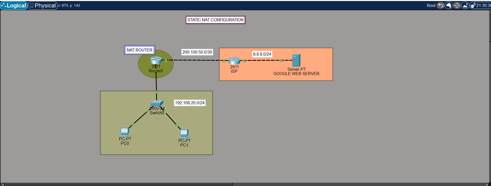

# Static NAT and OSPF Lab

This Cisco Packet Tracer project combines OSPF routing with a fixed, one-to-one Static NAT mapping. OSPF determines how routers reach remote networks; NAT translates the selected inside address. Both routing and a valid return path are required for end-to-end connectivity.

## Topology

The supplied logical diagram shows two internal PCs connected to a NAT router, an ISP router, and an external test server.

| Segment | Network shown in the diagram |
|---|---|
| Internal LAN | `192.168.20.0/24` |
| NAT router to ISP | `200.100.50.0/30` |
| External test-server segment | `8.8.8.0/24` |

These are labels from the simulation diagram. Check the `.pkt` file for the actual interface addresses, NAT mapping, OSPF process, and participating networks before applying commands.



## Configuration

The snippets below show the IOS command pattern. Replace every placeholder with values verified in the Packet Tracer project; these are templates, not a device configuration export.

### OSPF

Configure OSPF on each participating IOS router. Network statements match local interfaces using wildcard masks; advertise only networks that belong in the routing domain.

```cisco
configure terminal
router ospf <process-id>
 router-id <unique-router-id>
 network <network-address> <wildcard-mask> area <area-id>
end
```

Confirm neighbor relationships and learned routes before testing NAT. OSPF provides routing information; it does not translate addresses.

### Static NAT

On the NAT router, map the inside local address to its fixed inside global address, and mark the interfaces according to which side of the translation they face.

```cisco
configure terminal
ip nat inside source static <inside-local-ip> <inside-global-ip>

interface <inside-interface>
 ip nat inside
 exit

interface <outside-interface>
 ip nat outside
 exit
end
```

The inside global address must be reachable from the outside network, and routing must provide a return path. NAT does not add routes or override an access-control policy.

## Verification

Check interface state, routing, OSPF, and NAT separately so a failed ping can be narrowed to its cause.

```cisco
show ip interface brief
show ip ospf neighbor
show ip protocols
show ip route
show ip nat translations
show ip nat statistics
```

From an appropriate end device, test the external destination:

```text
ping <destination-ip>
traceroute <destination-ip>
```

A static translation may appear in the translation table before traffic is generated. Verify the configured mapping and the observed traffic behavior.

| Check | Before configuration | After configuration |
|---|---|---|
| Interface state and addressing | Record baseline | Confirm expected interfaces are up and correctly addressed |
| OSPF neighbors and routes | Record learned routes | Confirm required neighbors and destination routes |
| End-to-end connectivity | Record ping and traceroute | Repeat and compare results |
| NAT mapping and counters | Record current table/statistics | Confirm mapping and inspect counters after traffic |

If connectivity fails, confirm interface roles, matching OSPF networks, forward and return routes, the static mapping, and any applicable ACLs.

## Project Files

| File | Purpose |
|---|---|
| [Packet Tracer simulation](Static-NAT-configuration.pkt) | Editable topology and device configurations. |
| [Topology image](topology.png) | Logical view of the lab. |