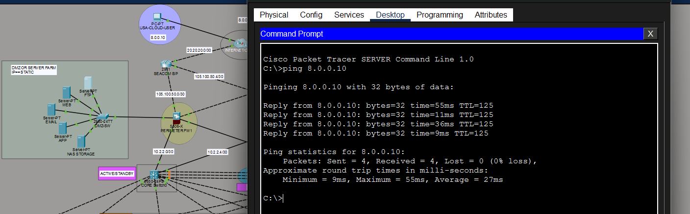

# Firewall ICMP Troubleshooting

## Incident

ICMP echo tests across the firewall path were failing. Investigation isolated the issue to incorrect ICMP configuration on the ASA firewall.

## Diagnosis and Resolution

The issue was identified by testing connectivity across the affected path and reviewing the firewall's ICMP handling. The ASA ICMP configuration was corrected for the traffic required by this lab.

The available notes and screenshots do not preserve the exact corrected command. This report therefore records the verified cause and outcome without guessing at an ACL or inspection command. Avoid treating the scratch `permit icmp any any` example as a production-ready policy; it permits ICMP broadly.

## Verification

After the correction, a DMZ-side host pinged the external test address `8.0.0.10` successfully:

| Destination | Sent | Received | Loss |
|---|---:|---:|---:|
| `8.0.0.10` | 4 | 4 | 0% |

